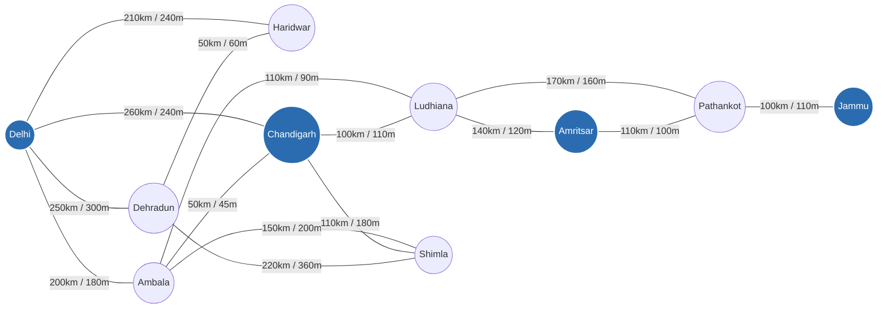

<div align="center">

# 🚆 Railway Tracking & Route Optimization System
### High-Performance Shortest Path & Fast-Transit Network Simulator in C

[](https://en.wikipedia.org/wiki/C99)
[](https://gcc.gnu.org/)
[](https://www.gnu.org/software/make/)
[](https://en.wikipedia.org/wiki/Dijkstra%27s_algorithm)
[](https://en.wikipedia.org/wiki/Binary_heap)
[logV)-brightgreen?style=for-the-badge)](#algorithmic-complexity)
[](#how-to-build--run)
[](LICENSE)

<br/>

<p align="center">
  <b>A production-grade Data Structures & Algorithms project modeling an intercity railway network.</b><br/>
  Computes optimal train routes using an accelerated <b>Binary Min-Heap Priority Queue Dijkstra's Algorithm</b> with dynamic dataset loading, live fare estimates, and multi-criteria optimization.
</p>

</div>

---

## 🛠️ Technology Stack & Tooling

<table>
  <tr>
    <td align="center" width="25%"><b>Category</b></td>
    <td align="center"><b>Technologies & Colorful Cards</b></td>
  </tr>
  <tr>
    <td align="center"><b>Core Language</b></td>
    <td>
      
      
    </td>
  </tr>
  <tr>
    <td align="center"><b>Compilers & Toolchain</b></td>
    <td>
      
      
      
    </td>
  </tr>
  <tr>
    <td align="center"><b>Data Structures</b></td>
    <td>
      
      
      
    </td>
  </tr>
  <tr>
    <td align="center"><b>Algorithms & Complexity</b></td>
    <td>
      
      
      
    </td>
  </tr>
  <tr>
    <td align="center"><b>Data & Persistence</b></td>
    <td>
      
      
    </td>
  </tr>
  <tr>
    <td align="center"><b>Version Control & Shell</b></td>
    <td>
      
      
      
    </td>
  </tr>
</table>

---

## 🌟 Key Highlights & Features

- **⚡ Min-Heap Accelerated Dijkstra**: Reduces linear node extraction $\mathcal{O}(V^2)$ down to $\mathcal{O}((V + E) \log V)$ using an in-place priority queue.
- **🎯 Dual-Criterion Optimization**: Seamlessly calculate either the **shortest track distance (km)** or the **fastest transit duration (minutes)**.
- **📂 Dynamic Dataset Loading**: Reads routes directly from `data/network.csv` with automatic fallback to an internal graph.
- **🔍 Smart Station Resolution**: Accepts either station names (case-insensitive, e.g., `delhi`, `jammu`) or numbered station indices.
- **🎟️ Multi-Tier Fare Calculator**: Simulates IRCTC-style ticket prices across 4 coach tiers: Sleeper (SL), AC 3-Tier (3A), AC 2-Tier (2A), and AC First Class (1A).
- **📋 Step-by-Step Leg Breakdown**: Displays intermediate stops, individual track distances, and segment runtimes.

---

## 🗺️ Railway Network Topology



---

## 📊 Algorithmic Complexity Matrix

| Operation | Standard Implementation | This Project's Implementation | Time Complexity | Space Complexity |
| :--- | :--- | :--- | :--- | :--- |
| **Graph Storage** | Adjacency Matrix | **Adjacency List** | $\mathcal{O}(1)$ insertion | $\mathcal{O}(V + E)$ |
| **Minimum Extraction** | Linear Scan $\mathcal{O}(V)$ | **Min-Heap (`extractMin`)** | $\mathcal{O}(\log V)$ | $\mathcal{O}(V)$ |
| **Distance Update** | Linear Assignment | **Heap `decreaseKey` via `pos[]`** | $\mathcal{O}(\log V)$ | $\mathcal{O}(1)$ auxiliary |
| **Pathfinding (SSSP)** | Array-based Dijkstra | **Min-Heap Dijkstra** | **$\mathcal{O}((V + E) \log V)$** | $\mathcal{O}(V)$ auxiliary |
| **Path Reconstruction** | Manual scan | **Parent Pointer Backtracking** | $\mathcal{O}(V)$ | $\mathcal{O}(V)$ |

---

## 📁 Repository Organization

```text
Railway-Management-System/
├── 📁 data/
│   └── network.csv           # Railway tracks, distances (km), and runtimes (min)
├── 📁 include/
│   ├── graph.h               # Adjacency list & station structure definitions
│   ├── minheap.h             # Priority queue structure & heapify prototypes
│   └── dijkstra.h            # Pathfinding & fare calculation prototypes
├── 📁 src/
│   ├── graph.c               # Dynamic CSV parser & adjacency list builder
│   ├── minheap.c             # O(log V) Min-Heap (heapify, decreaseKey)
│   ├── dijkstra.c            # Shortest route finder & itinerary generator
│   └── main.c                # Interactive command-line interface
├── 📄 build.bat              # One-click Windows build script
├── 📄 Makefile               # Unix/Linux/macOS automated compilation
├── 📄 .gitignore             # Compiler artifact exclusions
└── 📄 README.md              # Project documentation with tech stack cards
```

---

## ⚡ How to Build & Run

### 🪟 Windows (MinGW / GCC)
Run the automated build script:
```powershell
.\build.bat
.\railway_tracker.exe
```

Or compile directly with GCC:
```powershell
gcc -Wall -Wextra -std=c99 -Iinclude src/main.c src/graph.c src/minheap.c src/dijkstra.c -o railway_tracker.exe
.\railway_tracker.exe
```

### 🐧 Linux / 🍎 macOS
```bash
make
./railway_tracker
```

---

## 💻 Sample Terminal Output

```text
============================================================
            SHORTEST ROUTE (OPTIMIZED FOR DISTANCE)         
============================================================

Path Itinerary:
  [Start] Delhi
     | 
     +---> Ambala    (Leg: 200 km, 180 min)
     | 
     +---> Ludhiana  (Leg: 110 km, 90 min)
     | 
     +---> Pathankot (Leg: 170 km, 160 min)
     | 
     +---> Jammu     (Leg: 100 km, 110 min)

Summary:
  * Total Stops    : 5 stations (3 intermediate stops)
  * Total Distance : 580 km
  * Total Duration : 9 hours 0 minutes (540 mins)
============================================================

--- Estimated Ticket Fares ---
+----------------------+-------------------+
| Travel Class         | Approx. Fare (INR)|
+----------------------+-------------------+
| Sleeper Class (SL)   | Rs. 381           |
| AC 3-Tier (3A)       | Rs. 987           |
| AC 2-Tier (2A)       | Rs. 1536          |
| AC First Class (1A)  | Rs. 2358          |
+----------------------+-------------------+
```

---

## 🎓 Viva & Technical Interview Notes

<details>
<summary><b>Click to expand Viva Q&A Cheat Sheet</b></summary>
<br/>

1. **Why is Dijkstra preferred over Bellman-Ford here?**
   - Dijkstra's algorithm is optimal for graphs with **non-negative edge weights** (distances and durations can never be negative). It runs in $\mathcal{O}((V + E) \log V)$, whereas Bellman-Ford takes $\mathcal{O}(V \cdot E)$.
2. **Why use an Adjacency List instead of an Adjacency Matrix?**
   - Railway graphs are sparse ($E \ll V^2$). An Adjacency List consumes $\mathcal{O}(V + E)$ space compared to $\mathcal{O}(V^2)$ for a matrix, and allows iterating only over existing tracks rather than all $V$ potential vertices.
3. **How does `decreaseKey` achieve $\mathcal{O}(\log V)$ in C?**
   - We maintain an auxiliary `pos[]` array that maps each vertex ID to its current index in the heap array. This avoids searching through the heap in $\mathcal{O}(V)$ time, enabling direct $\mathcal{O}(1)$ lookup and $\mathcal{O}(\log V)$ bubble-up.

</details>

---

<div align="center">
  <sub>Developed by Ayush Raj • Built with ❤️ for Data Structures & Algorithms</sub>
</div>
