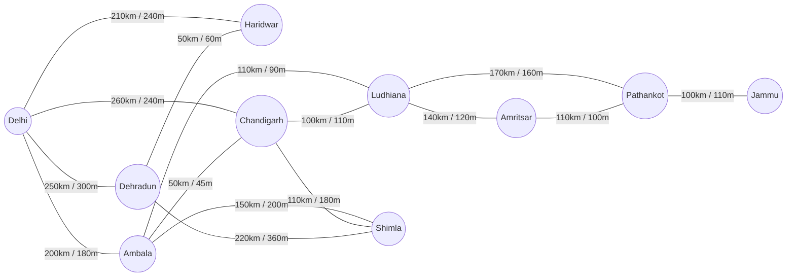

# Railway Tracking & Route Optimization System

An advanced C-based Data Structures and Algorithms (DSA) project that models a railway transport network and computes optimal transit routes between destinations using an optimized **Dijkstra's Algorithm with a Binary Min-Heap Priority Queue**.

---

## Key Highlights

- **Dual-Criterion Route Optimization**: Find routes either minimizing physical track distance (km) or minimizing total travel duration (minutes).
- **Min-Heap Accelerated Dijkstra**: Runs in **$\mathcal{O}((V + E) \log V)$** time rather than standard $\mathcal{O}(V^2)$ linear searches.
- **Dynamic Dataset Loading**: Reads station connectivity from `data/network.csv` with fallback to an internal graph.
- **Flexible Station Resolution**: Accepts either station names (case-insensitive, e.g. `delhi`, `jammu`) or numeric station IDs.
- **Fare Estimation Engine**: Computes realistic ticket fare estimates across Sleeper, AC 3-Tier, AC 2-Tier, and AC First Class.
- **Detailed Itinerary**: Visualizes intermediate stops, individual leg metrics, and total journey duration.

---

## Network Architecture



---

## Algorithmic Complexity

| Operation | Implementation | Time Complexity | Space Complexity |
| :--- | :--- | :--- | :--- |
| Edge Storage | Adjacency List | $\mathcal{O}(1)$ insertion | $\mathcal{O}(V + E)$ |
| Minimum Extraction | Min-Heap Priority Queue | $\mathcal{O}(\log V)$ | $\mathcal{O}(V)$ |
| Key Update (`decreaseKey`) | Tracked Position Array (`pos[]`) | $\mathcal{O}(\log V)$ | $\mathcal{O}(V)$ |
| Pathfinding (Dijkstra) | Min-Heap SSSP | $\mathcal{O}((V + E) \log V)$ | $\mathcal{O}(V)$ auxiliary |
| Route Backtracking | Parent Array Recursive / Iterative | $\mathcal{O}(V)$ | $\mathcal{O}(V)$ |

---

## Directory Structure

```text
railway-tracking-system/
├── data/
│   └── network.csv           # Railway tracks, distances, and runtimes
├── include/
│   ├── graph.h               # Adjacency list and graph definitions
│   ├── minheap.h             # Priority queue structure and prototypes
│   └── dijkstra.h            # Pathfinding & fare calculation definitions
├── src/
│   ├── graph.c               # Dynamic CSV parser and network builder
│   ├── minheap.c             # Min-heap operations (heapify, decreaseKey)
│   ├── dijkstra.c            # Dijkstra implementation & itinerary reporter
│   └── main.c                # Interactive command-line interface
├── build.bat                 # Windows one-click build script
├── Makefile                  # Unix/Linux/macOS build script
├── .gitignore                # Ignored compiler artifacts
└── README.md                 # Project documentation
```

---

## How to Build & Run

### On Windows (using MinGW / GCC):
Double-click `build.bat` or run:
```cmd
gcc -Wall -Wextra -std=c99 -Iinclude src/main.c src/graph.c src/minheap.c src/dijkstra.c -o railway_tracker.exe
.\railway_tracker.exe
```

### On Linux / macOS:
```bash
make
./railway_tracker
```

---

## Interactive Menu Options

1. **View All Stations**: Displays index and name for all available stations.
2. **Find Shortest Route (Distance)**: Computes the minimum kilometer path between any two stations.
3. **Find Fastest Route (Time)**: Computes the route with the shortest cumulative transit duration.
4. **Inspect Direct Connections**: Lists all direct lines outgoing from any chosen station.
5. **Custom Fare Calculator**: Computes estimated fares for arbitrary travel distances.
6. **Reload Network Dataset**: Re-reads `data/network.csv` without restarting the application.
